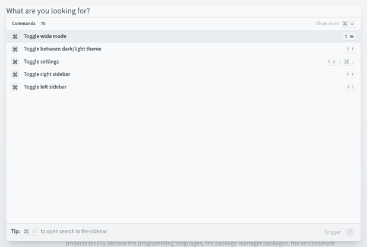
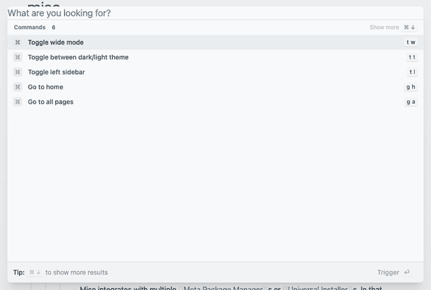
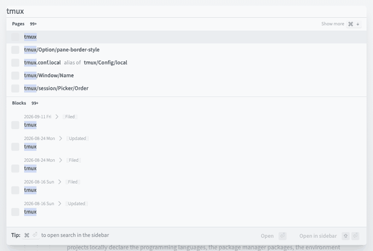
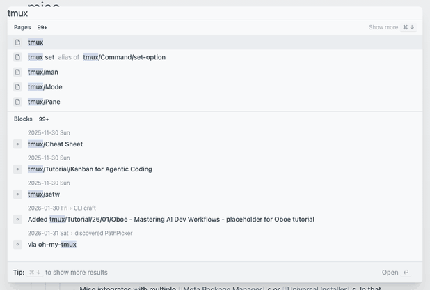
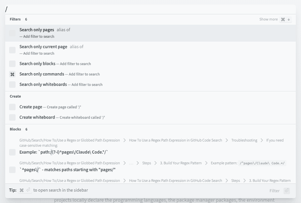
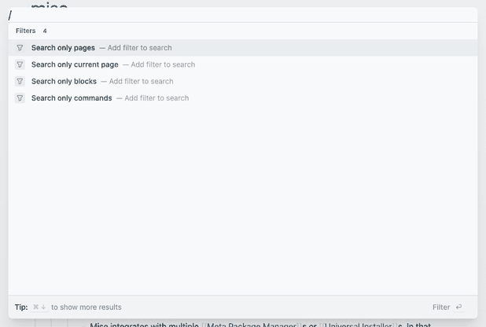
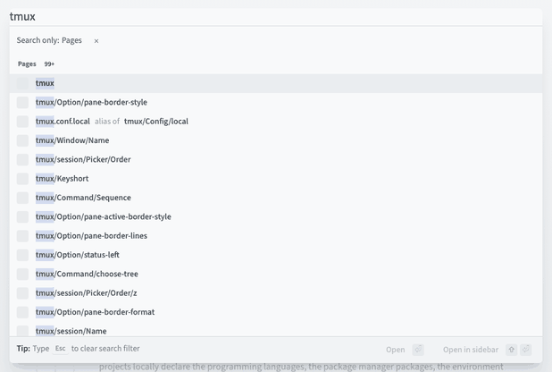
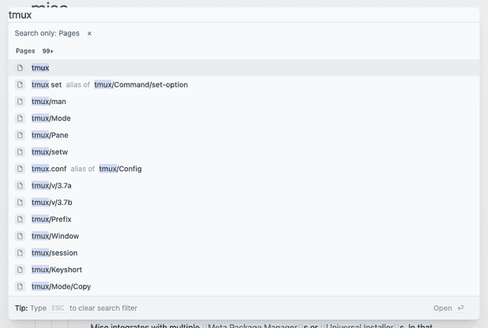
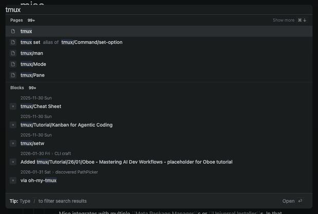

# Verification

## Dialog look (task 4.6)

The `lsg` dialog matches every measured Logseq style below at 1280×800 in the light theme. Logseq's group order, five rows and highlight colour match too; its page ranking and its icons differ, as listed under Remaining differences.

Measured on 2026-10-27 in headless Chromium (Playwright 1.60) at 1280×800, light theme, on the `mise` page with the query `tmux`:

- Logseq: the encode garden's `gh-pages` build `b491e004`, served locally.
- `lsg`: this branch, a release build of encode garden commit `75ef84c6` with the `parity:build` options plus `--search`.

| Element | Property | Logseq | lsg |
| --- | --- | --- | --- |
| Dialog | `width` | `896px` | same |
| Dialog | `borderRadius` | `8px` | same |
| Dialog | `backgroundColor` | `rgb(236, 238, 240)` | same |
| Input row | `backgroundColor` | `rgb(248, 249, 250)` | same |
| Input row | `borderBottom` | `1px solid rgb(215, 219, 223)` | same |
| Input | `fontSize` | `20px` | same |
| Input | `lineHeight` | `28px` | same |
| Input | `padding` | `0px` | same |
| Input | `backgroundColor` | `rgba(0, 0, 0, 0)` | same |
| Results area | `height` | `520px` | same |
| Results area | `backgroundColor` | `rgb(248, 249, 250)` | same |
| Results area | `padding` | `0px 0px 56px` | same |
| Group | `borderBottom` | `1px solid rgb(223, 227, 230)` | same |
| Group | `padding` | `0px 0px 4px` | same |
| Group header | `height` | `32px` | same |
| Group header | `fontSize` | `12px` | same |
| Group header | `color` | `rgb(104, 112, 118)` | same |
| Group header | `padding` | `6px 12px` | same |
| Group name | `fontWeight` | `700` | same |
| Count badge | `fontSize` | `11.2px` | same |
| Count badge | `color` | `rgb(17, 24, 28)` | same |
| Show more | `opacity` | `0.5` | same |
| Show more | `fontSize` | `12px` | same |
| Key chip | `height` | `20px` | same |
| Key chip | `backgroundColor` | `rgb(241, 243, 245)` | same |
| Key chip | `borderRadius` | `4px` | same |
| Row | `padding` | `6px 12px` | same |
| Row | `opacity` | `0.8` | same |
| Highlighted row | `backgroundColor` | `rgba(0, 37, 73, 0.055)` | same |
| Highlighted row | `opacity` | `1` | same |
| Icon box | `width` | `20px` | same |
| Icon box | `height` | `20px` | same |
| Icon box | `backgroundColor` | `rgb(230, 232, 235)` | same |
| Icon box | `borderRadius` | `4px` | same |
| Row text | `fontSize` | `14px` | same |
| Row text | `fontWeight` | `500` | same |
| Row text | `lineHeight` | `20px` | same |
| Highlight span | `backgroundColor` | `rgb(198, 212, 249)` | same |
| Breadcrumb | `fontSize` | `12px` | same |
| Breadcrumb | `fontWeight` | `300` | same |
| Breadcrumb | `color` | `rgb(104, 112, 118)` | same |
| Breadcrumb | `padding` | `0px 0px 0px 32px` | same |
| Footer | `backgroundColor` | `rgb(241, 243, 245)` | same |
| Footer | `borderTop` | `1px solid rgb(215, 219, 223)` | same |
| Footer | `padding` | `8px 12px` | same |

The dark theme uses the existing theme tokens, as the [search analysis](../../../docs/parity/search.md) left Logseq's dark values unmeasured; the highlight uses `--lsg-ref-hover` and the highlighted row `--lsg-guide`.

### Screenshots

Each pair shows Logseq first, then `lsg`, cropped to the dialog.

| State | Logseq | lsg |
| --- | --- | --- |
| Empty input |  |  |
| `tmux` |  |  |
| `/` |  |  |
| `Search only pages`, then `tmux` |  |  |
| `tmux`, dark theme | not measured |  |

### Remaining differences

- **Page order.** For `tmux`, Logseq lists `tmux/Option/pane-border-style` and `tmux.conf.local` after `tmux`; `lsg` lists the alias `tmux set` and the shortest titles. Both put the exact title first, which is what the spec requires; the ranking comes from the engine, not the dialog.
- **Icons.** Logseq's published build shows empty grey icon boxes, because its icon font does not load; `lsg` draws page, block, command and filter icons in the same 20×20 boxes.
- **Left out by design.** The Create group, the whiteboards and files filters, `Open in sidebar` and the `⌘ ⏎` sidebar tip (Issue #119).
- **Breadcrumbs.** Logseq draws parents as page references with brackets and chevron icons; `lsg` shows the parents' text separated by `›`.
- **Backdrop.** Logseq's wash has no measurable colour on its overlay element; `lsg` uses a gradient of the text colour at 6–9% opacity, which matches sampled backdrop pixels within 8 levels per channel.

## Gitpa navigation (task 4.7)

Gitpa's navigation tests pass with this branch, though they do not read a build.

- Gitpa commit `75cc8b83`, `node --test tests/navigation.test.js`: 20 of 20 pass.
- These tests load `site/navigation.js` with a mocked document; they read no published files, so the encode-garden build above could not be passed to them. Gitpa uses only `link[rel="lsg-search"]` and `window.logseqGardenerInitSearch(document, { resolvePage })` (`site/navigation.js`), and both are unchanged.
- `mise run search:browser-test` covers the same host contract against a real build: a host replaces `main` and the manifest link, calls the initializer again with `resolvePage`, and the one dialog keeps working.
- A full Gitpa site build (`scripts/build_site.py`) writes into the Gitpa checkout, so it was not run; nothing was written there.
